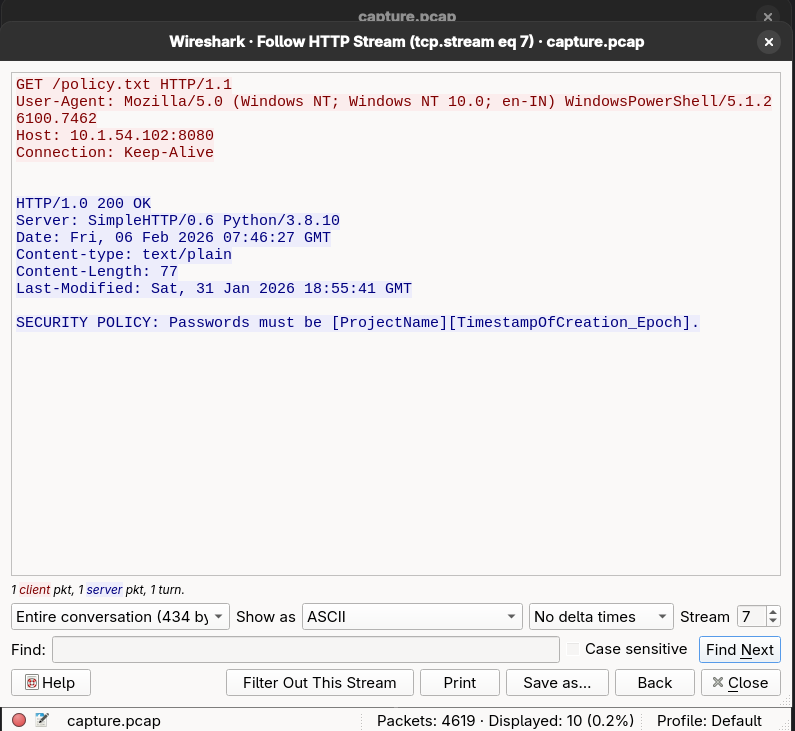
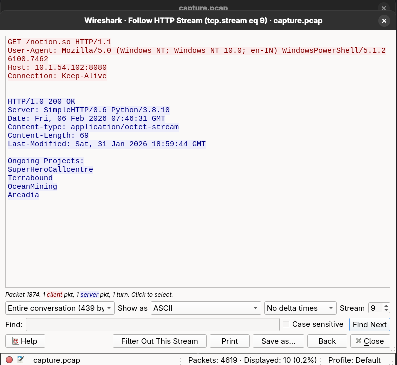
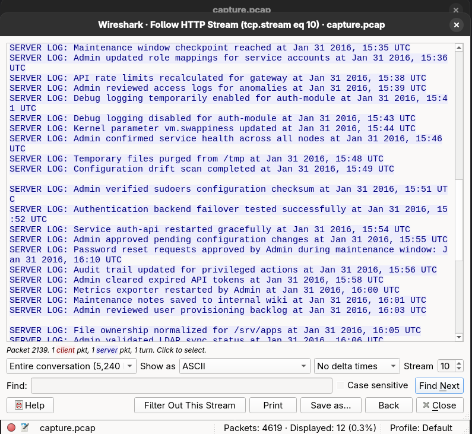
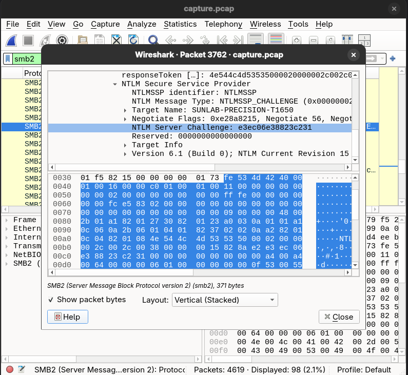
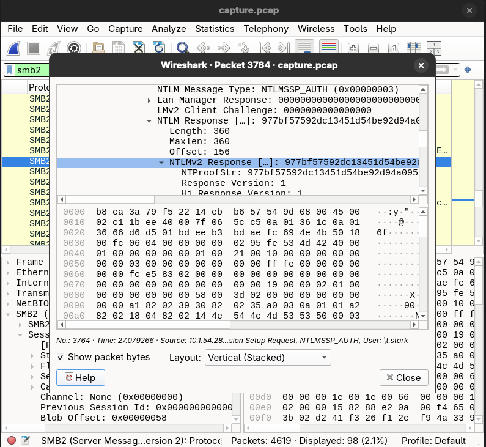
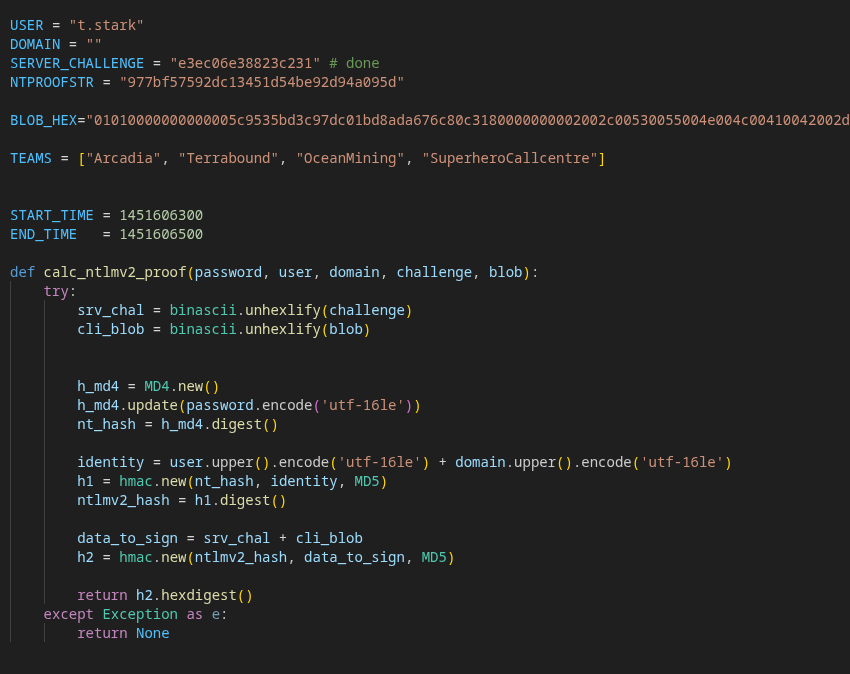

# $whoami – Forensic PCAP Analysis Writeup

## Challenge Description

An internal investigation flagged an anomalous access event involving a restricted internal resource.  
The activity blended in with normal network traffic and appeared to rely on **valid credentials**, not a software exploit.

A packet capture (`.pcap`) was provided for the suspected time window.

### Objectives
- Identify the **account** that accessed the restricted resource
- Recover the **credentials** used during the incident

**Flag format:**  
p_ctf{username:password}

---

## Initial Reconnaissance

The PCAP was opened in Wireshark and protocols were enumerated. The capture contained a mix of:

- HTTP
- SMB2
- SSH
- Miscellaneous background traffic

Given the challenge description mentioning *valid credentials* and *internal access*, **authentication-based protocols** were prioritized.

---

## HTTP Analysis – Password Policy & Timing

Inspecting the HTTP traffic revealed internal documentation and logs exposed over plaintext HTTP.

### Key Findings
- A **password policy** indicating passwords followed the format:
<ProjectName><EpochTimestamp>

- HTTP logs revealed the **approximate time window** when the anomalous access occurred

Using the timestamps present in HTTP responses, the likely **epoch range** used during password generation was narrowed down.

This information was later used to construct a **custom password wordlist**.

---

## SMB2 Analysis – Identifying the User

Next, SMB2 traffic was analyzed to identify access attempts to sensitive resources.

### Observations
- Multiple authentication attempts were present
- **Only one user successfully accessed restricted files**

The user identified from SMB2 sessions was:
t.stark

Other users either failed authentication or did not attempt to access protected resources.

---

## NTLMv2 Credential Extraction

From the SMB2 authentication exchange, the following NTLMv2 components were extracted:

- Username: `t.stark`
- Server Challenge
- NTLMv2 Response (Proof String)

This confirmed that **NTLMv2 authentication** was used and that offline password cracking was feasible.

---

## Password Cracking

Using the previously identified password policy and time window a script was used to crack the password offline with epochs starting from Jan 31 2016 and going backwards.

3. A successful match was found

### Cracked Credentials
Username: t.stark
Password: Arcadia1451606400

---

## Final Flag

p_ctf{t.stark:Arcadia1451606400}

---

## Conclusion

This challenge demonstrated how:
- Legitimate credentials can be abused without exploiting software vulnerabilities
- Seemingly harmless HTTP information can enable credential attacks
- NTLMv2 authentication can be cracked offline when weak, predictable password policies are used

A classic example of **credential-based lateral movement hiding in plain sight**.

