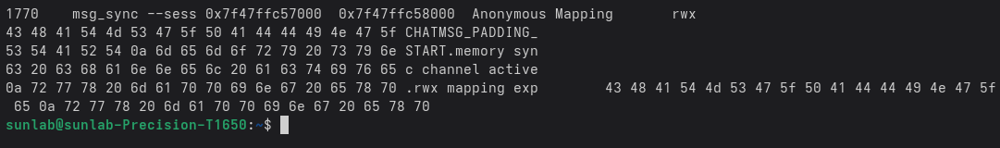
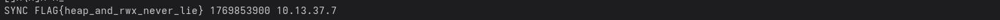
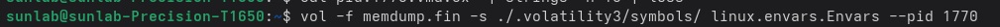

# Forensics Writeup – Catch Me If You Can

## Challenge Overview

A Linux server is suspected to have been compromised.

During the incident window, administrators observed suspicious user activity and abnormal process behavior, but no malicious binaries were recovered from disk.

You are provided with a full memory dump of the system taken shortly after the incident.

Initial triage suggests that an attacker may have:
- Accessed the system remotely
- Executed a malicious userspace program
- Exfiltrated sensitive session data before disappearing

The task is to analyze the memory dump and reconstruct the attacker’s activity.

---

## Objectives

Using only the provided memory dump, determine:

- The session key exfiltrated by the malicious process
- The epoch timestamp used during the exfiltration
- The IP address the program exfiltrated sensitive data to
- The ephemeral source port used by the attacker during remote access

Flag format:

p_ctf{<session_key>:<epoch>:<exfiltration_ip>:<ephemeral_remote_execution_port>}

---

## Initial Analysis

The memory dump is loaded into Volatility with the appropriate Linux kernel symbols.  
This enables accurate process enumeration and memory structure analysis.

---

## Process Enumeration

Using `pslist`, all processes present at the time of memory capture are enumerated.

Among normal system processes, a suspicious entry is identified:

- Process name: msg_sync  
- PID: 1770  

The process name does not correspond to a known system service and stands out in the context of the incident.

---

## Detecting Malicious Memory Regions

To identify injected or malicious userspace code, `malware.malfind` is executed.

The results indicate that the process `msg_sync` (PID 1770) contains:
- Writable and executable (RWX) memory regions
- No backing file on disk

These characteristics strongly suggest injected userspace code and confirm `msg_sync` as the malicious process.

---

## Process Memory Inspection

### Dumping Memory Maps

The memory mappings for PID 1770 are dumped using `proc.maps`.
`vol -f memdump.fin -s ./.volatility3/symbols linux.proc.Maps --pid 1770 --dump`

Manual inspection of the dumped memory reveals plaintext artifacts embedded directly in memory. These include:
- A session key
- An epoch timestamp
- A destination IP address

These values appear to be part of the runtime exfiltration logic, explaining why no disk artifacts were recovered.

Recovered values:
- Session key: heap_and_rwx_never_lie
- Epoch timestamp: 1769853900
- Exfiltration IP: 10.13.37.7

---

## Environment Variable Analysis

To determine how the attacker accessed the system, the environment variables of the suspicious process are examined using `linux.envars`.

The environment block for `msg_sync` contains SSH-related metadata, including the ephemeral source port used during the remote session.

Recovered value:
- Ephemeral remote execution port: 57540

This confirms that the attacker accessed the system remotely via SSH using a high-numbered, short-lived source port.

---

## Attack Reconstruction

By correlating:
- Process listings from `pslist`
- RWX memory regions from `malware.malfind`
- Plaintext artifacts from process memory maps
- SSH metadata from environment variables

the attacker’s activity can be fully reconstructed using memory forensics alone.

The attacker executed a userspace payload directly from memory, exfiltrated sensitive session data, and exited without leaving disk-based evidence.

---

## Final Flag

p_ctf{heap_and_rwx_never_lie:1769853900:10.13.37.7:57540}

---

## Takeaways

- Memory-only malware still leaves strong forensic evidence
- RWX memory regions are reliable indicators of injected userspace code
- Environment variables can leak critical session metadata
- Disk forensics alone is insufficient for modern incident response

Heap and RWX never lie.
