# Dead Joke – Official Writeup

## Challenge Description

The Joker left only one thing at the crime scene: a single file named **`smile.bin`**.

No threats, no riddles, no recordings — just that file, and a smear of blood on the wall reading:

> “A joke’s only funny when you get it.”

Forensic analysts determined that the file contains multiple layers of hidden data. 
Formats appear corrupted, stitched together, and deliberately misleading — consistent with the suspect’s prior behavior. 

This document outlines the intended solution.

---

## Files Provided
- `smile.bin`

---

## Flag Format
`p_ctf{why_50_53r10u5}`

---

## Intended Solve Path

### 1. Initial File Analysis & Carving

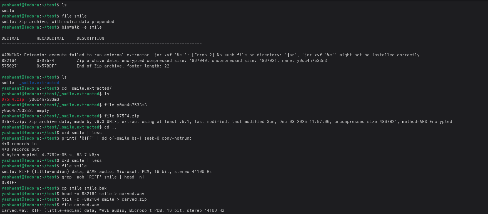

`smile.bin` does not begin with a valid file signature; the first four bytes of the WAV portion were intentionally modified.  
Changing `FAKE` → `RIFF` restores the correct WAV header.

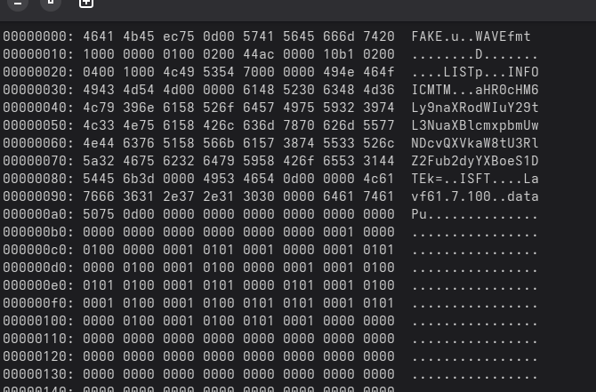

The binary contains multiple concatenated structures. Carving produces:

- A WAV file at the beginning  
- A 7z archive beginning at offset `0xD75F4`  
- An ASCII marker string  
- A GPG-encrypted file at the end  

All of these components are required to solve the challenge.

---

### 2. Audio LSB Steganography

Inspecting the recovered WAV file reveals metadata hinting at LSB steganography.  

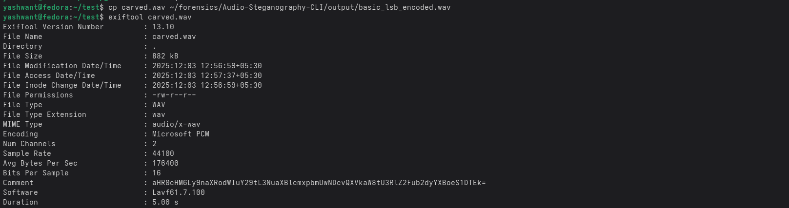

Extracting least significant bits from the audio samples reveals the **password for the 7z archive**.

---

### 3. Identifying the GPG Key

Running:
Analysing the file for strings gives us the gpg key

strings -n 6 smile.bin 

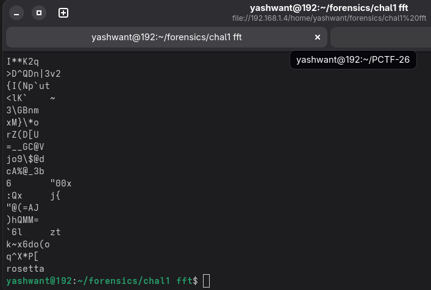

reveals an ASCII key between the 7z archive and the GPG block.  
This key decrypts `encode.txt.gpg`.

The decrypted text provides a poem describing a frequency-domain encoding method based on rings, angular slots, and mirroring.

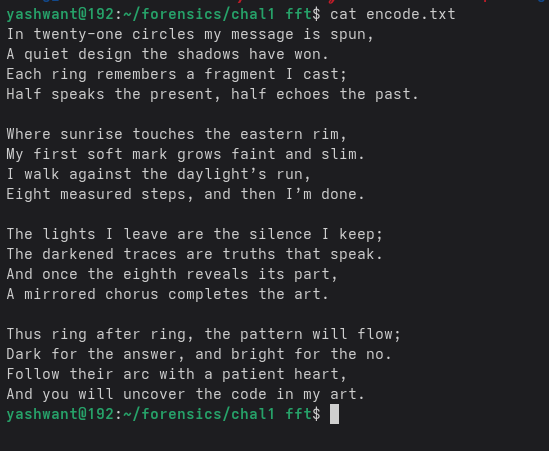
---

### 4. Extracting the Embedded PNG

Using the password obtained from the WAV stego, the 7z archive can be opened.  
It contains a PNG file, which provides:

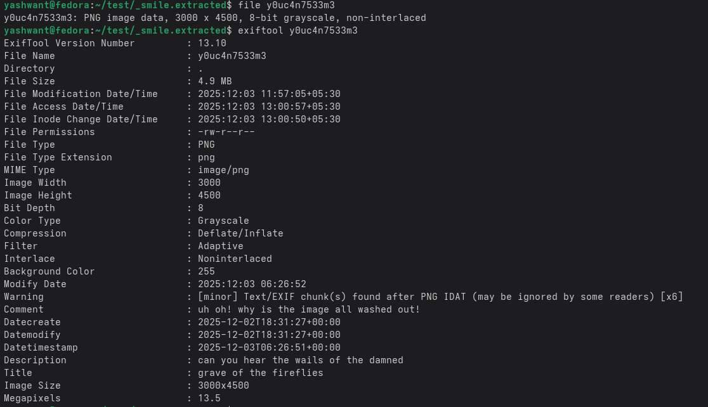

- A reference to XOR along with the XOR key  
- Visual distortion encouraging frequency-domain inspection  

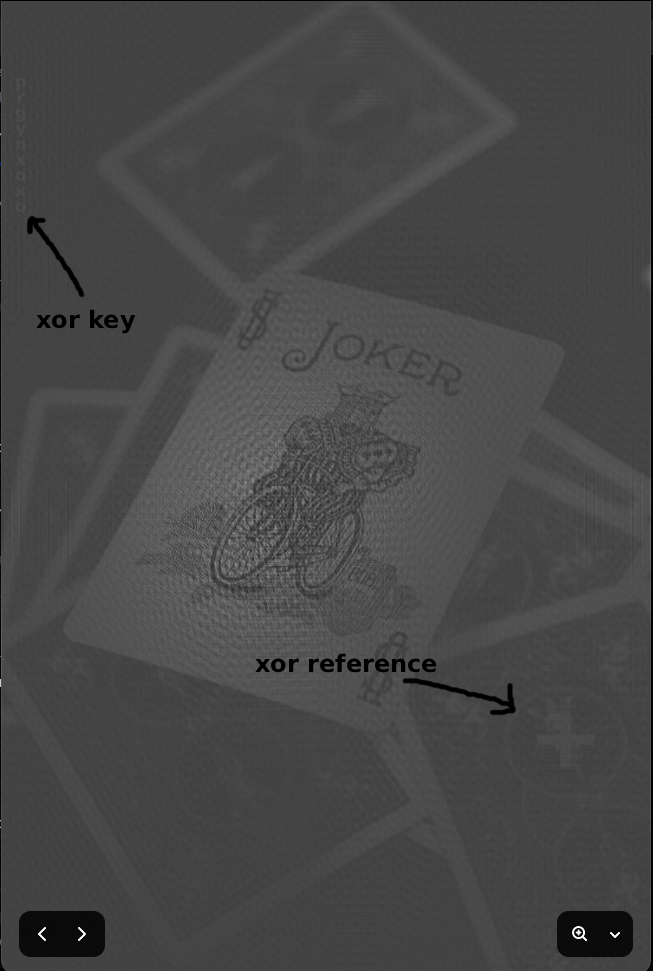
---

### 5. FFT Log-Magnitude Analysis

Converting the PNG to grayscale and examining its FFT log-magnitude reveals:

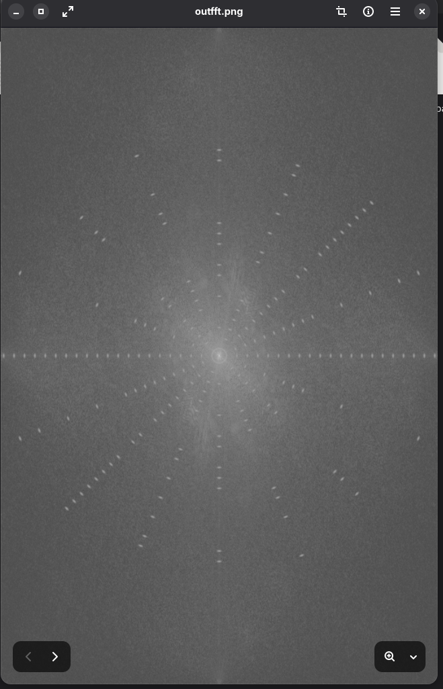

- **21 concentric rings**  
- Each ring divided into **16 angular slots**  
- Only the first **8 slots** carry meaningful bits  
- 0° begins along the +X axis  
- Angles increase anticlockwise  
- **Bright = 0**, **Dark = 1**  
- Opposite slots mirror to maintain conjugate symmetry  

These details match the rules explained in the recovered poem.

---

### 6. Decoding the Embedded Data

Following the poem’s rules:

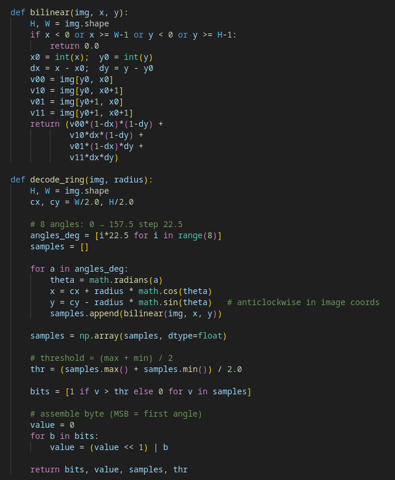

- Each ring represents one byte  
- The eight data slots (MSB → LSB) give the bit sequence  
- The 21 recovered bytes form a data stream  
- A cyclic bitwise XOR (hinted in the PNG) must be applied  

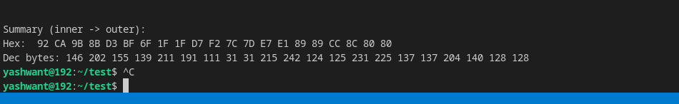

Decoding and applying the XOR yields the final message.

---

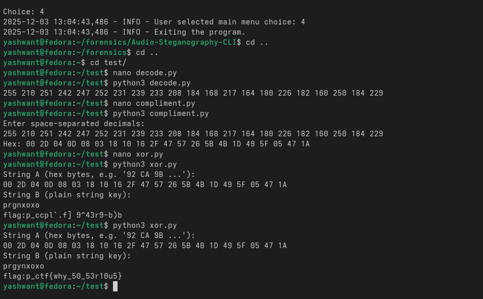

## Final Flag
`p_ctf{why_50_53r10u5}`

---
