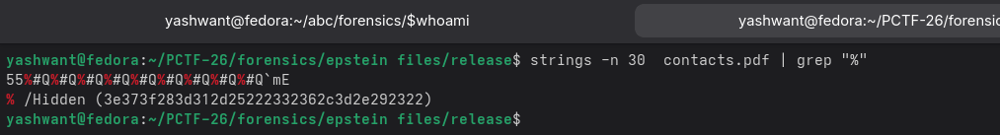
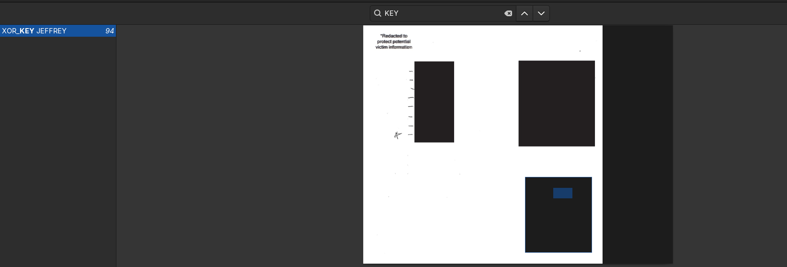
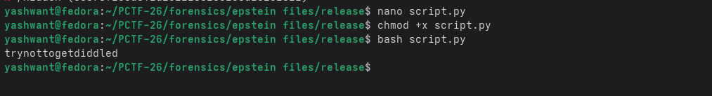
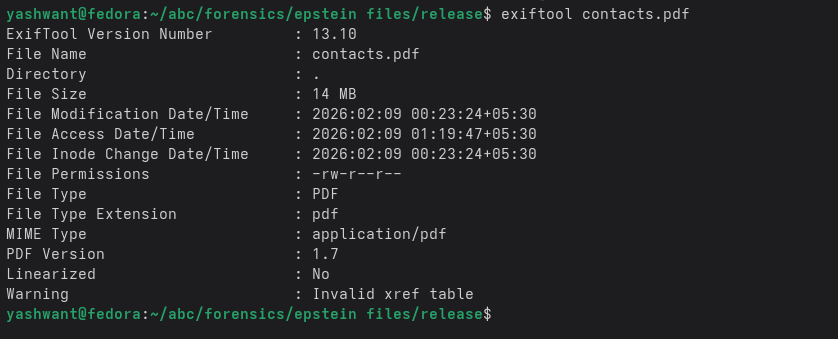
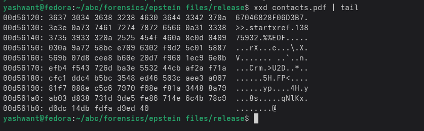
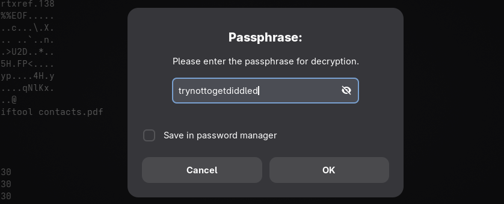
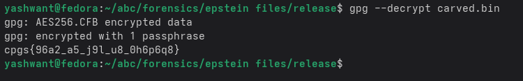

# Epstein Files – Forensics Writeup

## Challenge Description

You are provided with a PDF file related to an ongoing investigation.  
The document appears complete, but not everything is as it seems.

Analyze the file carefully and recover the hidden flag.

**Flag format:**  
pctf{...}


---

## Initial File Analysis

The provided file appears to be a valid PDF and opens normally in standard PDF viewers.  
However, given the challenge description, further inspection beyond surface-level rendering was required.

---

## Step 1: Inspecting PDF Comments

PDF files support comments beginning with the `%` character.  
Searching the file contents for such comments revealed an unusual **hex-encoded payload** embedded inside the PDF.


This payload did not appear to be part of normal PDF structure, indicating deliberate concealment.

---

## Step 2: Recovering the XOR Key

While inspecting the document further, **improper redaction artifacts** were discovered.

The XOR key:

JEFFREY


This key could be recovered using multiple methods:
- Using the **Find** feature in a PDF viewer
- Selecting all text (`Ctrl + A`) and pasting into a text editor
- Extracting text via the CLI using:
  ```bash
  pdftotext file.pdf

## Step 3: Decoding the Hex Payload

The extracted hex payload was XORed with the recovered key (JEFFREY).

This revealed the passphrase:

trynottogetdiddled

## Step 4: Metadata & Structural Analysis

Next, the PDF metadata was analyzed using:

exiftool file.pdf

Key Observation

The PDF contained an invalid XREF table

This commonly indicates that extra data has been appended after the %%EOF marker.

## Step 5: Detecting and Carving Trailing Data

A hex analysis confirmed that data existed after the PDF EOF marker.

The trailing data was carved out from the file and saved separately.

Upon inspection, the carved data was identified as:

GPG-encrypted content

## Step 6: Decrypting the Embedded Data

Using the previously recovered passphrase:

trynottogetdiddled


The GPG data was successfully decrypted, revealing a jumbled flag string.

## Step 7: Final Decoding (ROT18)

The decrypted output was still obfuscated.

Applying ROT18:

ROT13 for alphabetic characters

ROT5 for digits

Produced the final flag.


---
## Final flag
pctf{41n7_n0_w4y_h3_5u1c1d3}

## Conclusion

This challenge combined multiple forensic techniques:

PDF structure analysis

Hidden comments and improper redaction

XOR decoding

Metadata inspection

EOF data carving

Cryptographic analysis

Classical cipher decoding