# Plumbing — Solve Path

This challenge is a post-mortem Docker forensics problem. The container has already executed, already shipped, and already been “cleaned up”. Running the container or inspecting the final filesystem does not reveal the flag. The goal is to reconstruct what happened during the image build by analyzing Docker’s layered filesystem history.

The core idea is that Docker images are immutable and layered: deleted or overwritten files do not disappear, they remain accessible in earlier layers.

## Step 1: Initial Inspection

We are given a Docker image archive named app.tar.

Attempting to run the container yields nothing useful:

docker run --rm app
docker run --rm -it app sh

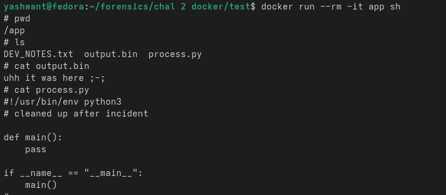

Observations:
- output.bin contains a misleading message
- process.py appears cleaned or neutered
- No plaintext secrets are visible
- No runtime interaction helps

This strongly suggests the challenge is not runtime-based and must be solved via Docker image forensics.

## Step 2: Extract the Docker Image

Docker images saved using docker save follow the OCI image layout. We extract the archive:

tar -xf app.tar
cd app

This produces:

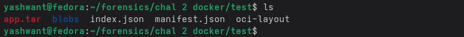

This confirms we are working with a Docker/OCI image archive.

## Step 3: Understand Layer Ordering

Open manifest.json:

cat manifest.json

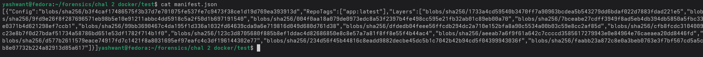

Inside, we find a list of filesystem layers under the Layers key.

Important facts:
- Layers are ordered from oldest to newest
- Earlier layers contain historical filesystem states
- Later layers may overwrite or delete files
- Deleted files still exist in older layers

Therefore, forensic analysis requires inspecting earlier layers.

## Step 4: Extract All Filesystem Layers

To analyze the full history, extract every filesystem layer individually:

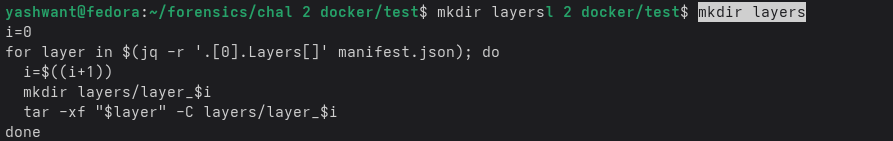
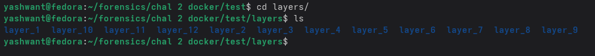

Each layer_X represents a filesystem delta at a specific point in time.

## Step 5: Reconnaissance Across Layers

The historical process.py hints at the transformation used and the filenames to look out for.

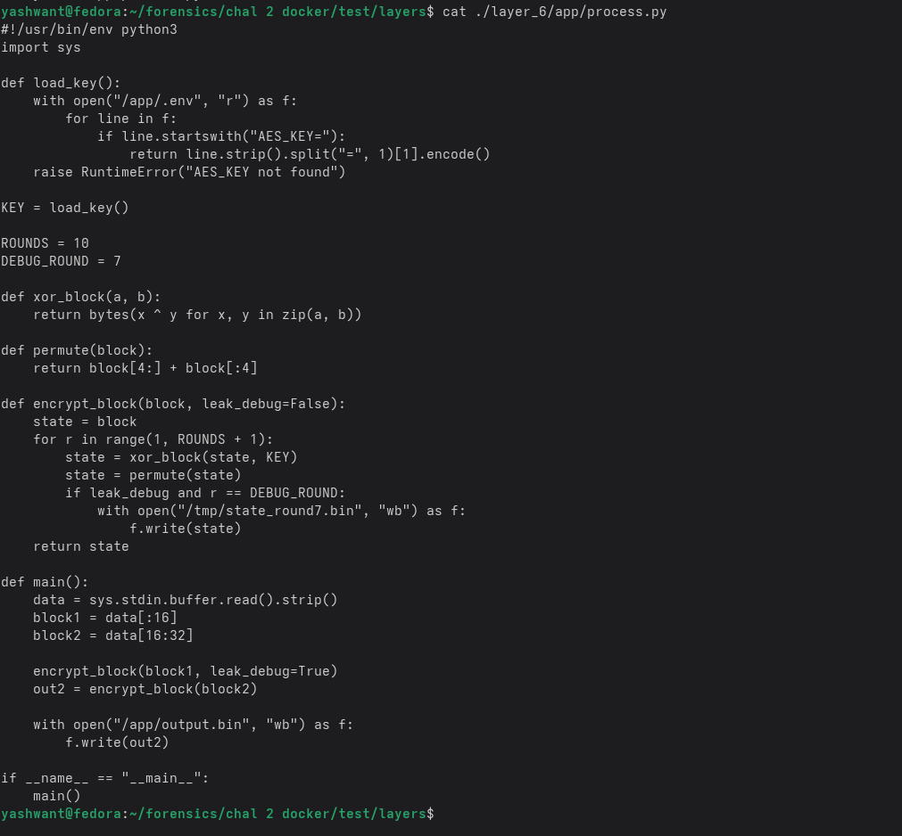

Debug Artifact

Search for deleted debug files:

find layers -name state_round7.bin

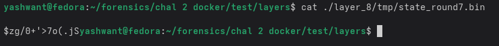

This file does not exist in the final filesystem, indicating it was deleted later. This strongly suggests a debug artifact that leaked internal state during execution and was later cleaned up.

env file:

find layers -name .env

layers/layer_7/app/.env

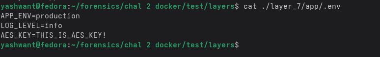

Overwritten Output

Search for output.bin across layers:

find layers -name output.bin

Earlier layers contain binary data. The final layer contains a misleading message. This indicates the real output was overwritten rather than removed.

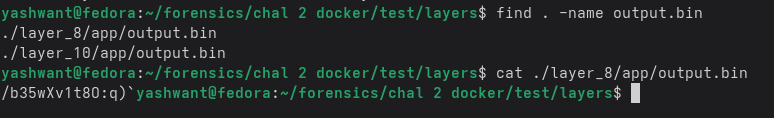

## Step 6: Understanding the Processing Logic

From the historical process.py:

- Input is read via standard input
- Input is split manually into two 16-byte blocks
- Each block undergoes 10 rounds of transformation
- Each round consists of:
  1. XOR with a key
  2. Rotate the block left by 4 bytes
- A debug dump is written at round 7 for block 1
- The final output of block 2 is written to output.bin

Thus:
- Block 1 leaks an intermediate state
- Block 2 leaks a final state
- Both can be reversed independently

We now have the key and state_dumps to reverse engineer the original input message.

## Step 7: Recovering the flag

### Artifact 1:
/tmp/state_round7.bin

This represents the internal state after round 7 of block 1.

To recover the original plaintext:
- Reverse the transformation 7 times
- Per round:
  - Rotate right by 4 bytes
  - XOR with the key

### Artifact 2:
/app/output.bin

From an earlier layer, retrieve the original output.bin.

This represents the state after 10 rounds of block 2.

Reverse the transformation 10 times using the same inverse operations.

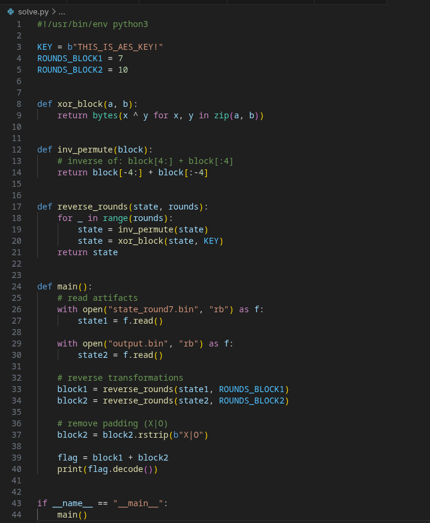

## Step 8: Flag Reconstruction

Concatenate both recovered blocks and remove the padding:

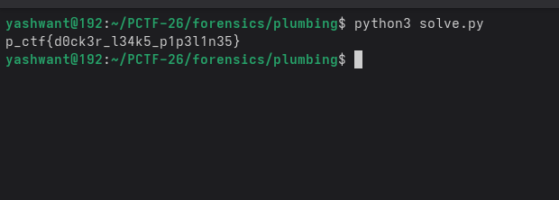

---

## Final Flag

p_ctf{d0ck3r_l34k5_p1p3l1n35}

## Key Insight

The flag was never stored directly. It was reconstructed by walking the Docker image timeline. Docker images preserve history even when files are deleted or overwritten. This challenge demonstrates post-mortem container forensics and the importance of historical analysis over runtime interaction.
